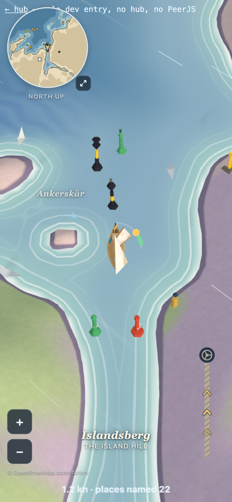
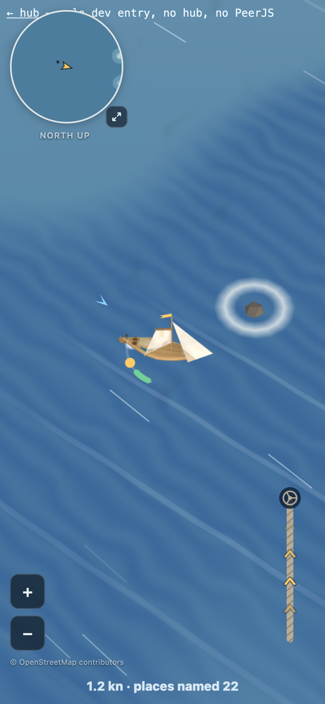
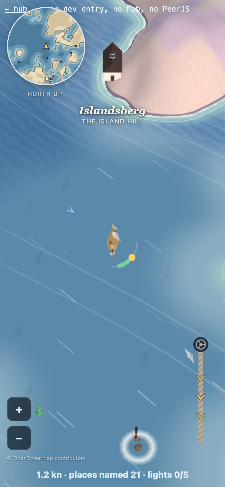
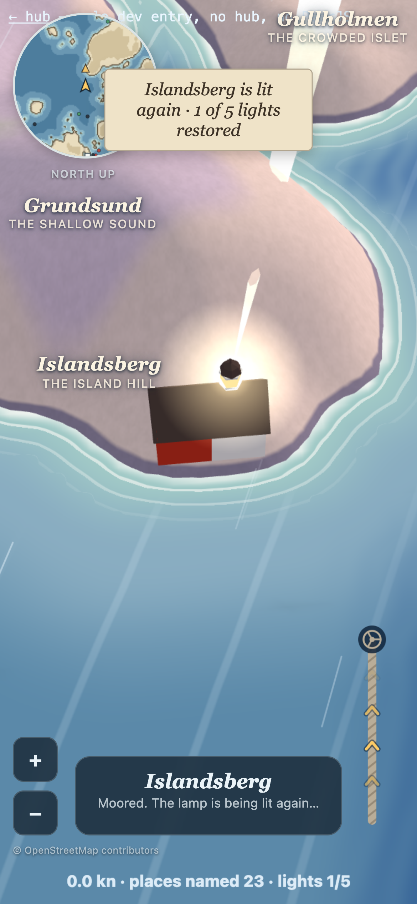
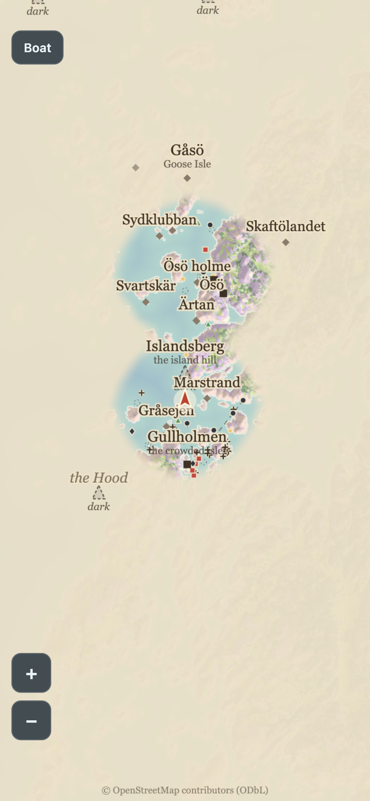
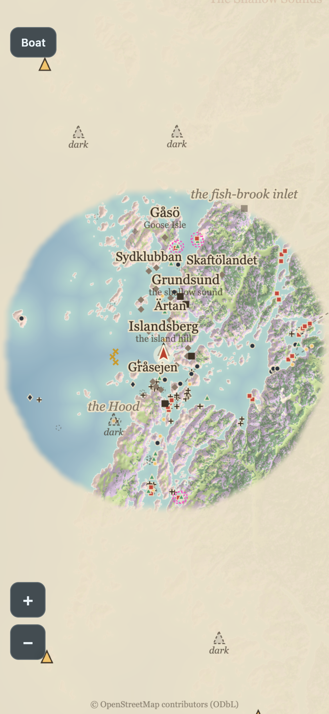
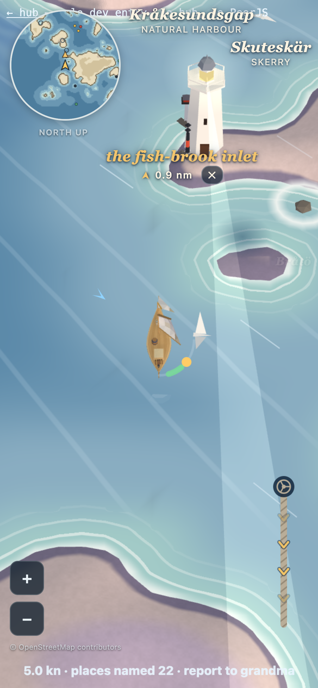
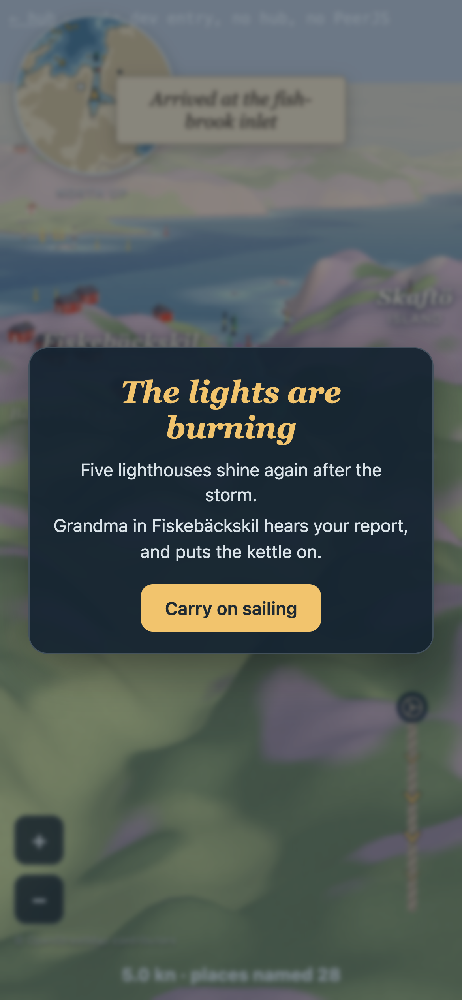
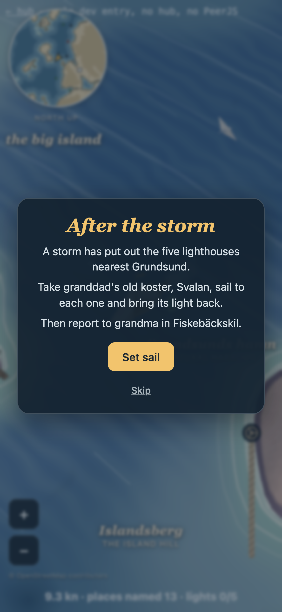
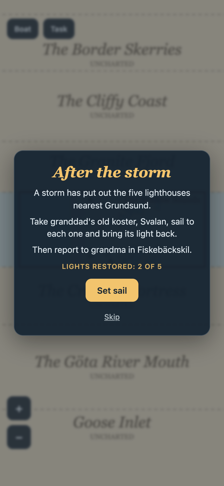

# Stage 1d: the dark lighthouses

Branch `felix/windward-lighthouse-task` (from main after 1c, the passes data and the seamarks data). Gated batches; screenshots in
`docs/lighthouse-task/`.

## Batch 1: the water tells the truth

- **Passes.** `loadRealCoast` carves `passes.json` (`applyPasses`, tiers `GAME_PASS_TIERS = ['ship', 'harbour']`) between building the world
  and building the terrain, so meshes and collision both see the carved coast. Today that is the 5 ship passes (689 cells). Any `harbour`
  tier rows added to `passes.json` later (the harbour approaches) are carved with no code change; the eye tier is never carved.
- **Shoals** (`src/sea-truth.js`, `src/shoal-look.js`, 292 rows). 210 are hard (awash / dry rocks and the 9 named båd / flu shoals): solid like
  land, with a soft white surf ring and a granite stub; the boat slides off, never through (a test sails at every one from four sides; in the
  game the boat stopped at 4.9 m = rock 2.4 + hull 2.5). 82 are soft (submerged, unknown, wreck, obstruction): faint darker water, the boat slows
  (0.5 to 0.7), never stops. Hard shoals enter a *sailing* height field (`coast.sailHeightAt`, spikes above `BLOCK_H`), so terrain, trees and
  names keep the plain coast and every shore rule (`stepAlongShore`, `hullHeight`) just works.
- **Marks** (`src/seamark-layer.js`, kit `src/seamark-meshes.js`): all 226 rows (80 laterals + the 20 invented gate marks, cardinals, isolated
  dangers, specials, lit beacons), built lazily within 420 m of the camera focus, buoys riding the real waves. **Invented gates are built exactly
  like real marks**; only the chart shows them, and only with `?debug=1` (dashed magenta ring; the 3D view rings them too in debug).
  Leading lines: OSM gives alignments anchored on an existing beacon (one end of each line coincides with a real mark), so there are no
  front/rear beacons to invent: they are a dashed chart overlay only.
- **No decorative buoys any more.** Stage 1b's life layer invented random red/green/yellow buoys near villages. `createLife({ marks })` now takes
  the real positions: gulls perch on real marks, the cones are not drawn, the minimap dots are the real laterals / specials (black for cardinals
  and dangers).
- **Chart:** marks, rock crosses, dotted submerged rings and leading lines appear from 0.22 px/m, only where the fog has lifted.
- **Credit:** "© OpenStreetMap contributors" in the 3D view (bottom left, above the speed line) and on the chart ("(ODbL)"); it is also in both
  data files and in `seamark-meshes.js`. ODbL is share-alike for the data.
- **Night hook (night is not built):** `setNight(on)` on the layer and `wantsReflectorGlint(spec, night)` (unlit buoys get a faint glint near the
  boat, `GLINT_RADIUS_M` 40). TODO(felix, night stage): draw the glint.

Performance at Fiskebäckskil (headless software GL: counts matter, fps does not), main vs this branch:

| pose | build | triangles | draw calls | main-thread ms/frame |
|---|---|---|---|---|
| quay (30 m from the village) | main | 324,284 | 227 | 2.26 to 2.52 |
| | branch | 345,362 | 272 | 2.19 to 2.50 |
| the mouth (63 marks in range) | main | 292,966 | 165 | 2.21 to 2.29 |
| | branch | 314,040 | 211 | 2.16 to 2.23 |

So +21k triangles (the shoal layer is 19k in three instanced draws) and +45 draw calls (the marks near the boat); CPU per frame unchanged.
TODO(felix): real-phone fps; the shoal radii (`shoal-look.js`) and the 420 m mark radius are first guesses.

 

## Batch 2: the task

The storm put out the five lighthouses nearest the start: **Islandsberg, Hättan, Stångehuvud, Gäven, Kråksundsgap Södra** (`pickTaskLights`; Måseskär, out at sea, stays lit).

- **Dark and lit** (`src/lantern.js`): a dark lighthouse has a dull blue-grey lantern, no halo, no beam. A lit one glows warm, its halo flashes on its REAL pattern (`lightOnAt` from `lighthouses.js`: flash / occulting / on-off, counts, lengths and gaps, tested against all 29 towers), and a soft beam sweeps round (faint by day). Emissive only, no PointLight.
- **The chart and minimap mark them "dark"**: a hollow dashed grey triangle (with the word "dark" on the chart); lit ones are gold. The card says "Dark since the storm".
- **Moor** (`MOOR_M` 45 game m, `MOOR_MAX_SPEED` 3 m/s = 5.8 kn): close enough AND slow starts the relight; the boat is held. Too fast near a dark light: a quiet toast "Ease off to moor at the dark lighthouse" (at most every 25 s). The nearest sailable water is 4 to 12 m from each rock, so 45 m is comfortable; the camera sees about 45 m, so the tower is in view. TODO(felix): confirm by feel.
- **The sequence** (`src/relight.js`, one timeline, about 14 s): the visit view glides in (1.6 s), the camera turns once round the lighthouse (10 s, eased, ends north-up again), the light comes on MID-circle (the lamp warms up over 1.4 s) with a calm sound (`audio.relight()`: a warm chord swell and two soft chimes, nothing sharp), then half a second later the fog lifts on the chart in a wide circle (`REVEAL_RADIUS_M` 600 game m = 6 km real, growing from nothing over 2.6 s, `explored.reveal`), a short rest, and the camera returns to the boat. The toast says "Hättan is lit again · 2 of 5 lights restored".
- **Progress** (`windward.lights.v1` in localStorage): shown subtly in the HUD line ("lights 2/5"); `?lights=reset` forgets it. A "Navigate here" tag on a dark light does not clear on arrival: it clears when the light is lit.
- **After the fifth**: the goal is "report to grandma": a Navigate-here target on Fiskebäckskil is set automatically (and again after a reload while it is the goal), the HUD says "report to grandma". Arriving there shows the end card ("The lights are burning", `END_CARD` in `src/task-ui.js`), saves "done", and the HUD line goes quiet.
- **Camera**: the circle uses a yaw on the fixed camera (`updateFixedCamera(..., yaw)`); everywhere else the camera stays north-up.

     

## Naming fix: false namesakes (Felix's phone test, 2026-11-06)
OSM has two tiny skerries literally named "Marstrand" (relation/10250151 at 58.22683, 11.39477 and relation/10250555 at 58.19284, 11.41319, the second beside Islandsberg), which misleads beside the real Marstrand far south. Rule (`findFalseNamesakes` in `src/names.js`): a skerry or islet whose name equals a MAJOR place (a village or town in `places.json`, a settlement in `settlements-history.json`, or a famous name: Marstrand, Smögen, Lysekil, Käringön, Gullholmen, Grundsund, Fiskebäckskil) and which is not that place shows no name. "Is that place" = within 150 game m (1.5 km real) of a village of that name. The row is dropped from the name list, so it is never announced, never on the chart or minimap, never found. Small natural harbours are not major places. The game's load report lists what was hidden (`report.names.hiddenNamesakes`).
Hidden today, of 2,000+ OSM islands and skerries: **Marstrand (relation/10250151)** and **Marstrand (relation/10250555)**, nothing else. Kept on purpose: Gullholmen (1 m from the village), Käringön (15 m and 82 m), Härmanö (0 m), and Felix's harbours Dammholmen, Danholmen, Kråkholmen. A device that had "found" one of the two forgets it silently (the name book drops ids that no longer exist).

## Batch 3: the start screen (option A, Felix's pick)
A dimmed card over the live view the first time the game runs: **After the storm** / "A storm has put out the five lighthouses nearest Grundsund." / "Take granddad's old koster, Svalan, sail to each one and bring its light back." / "Then report to grandma in Fiskebäckskil." / **Set sail** and Skip (`START_CARD` in `src/task-ui.js`; Felix's copy, split into three short lines, plus the title).
- **Once:** `windward.start.v1` in localStorage; Set sail and Skip both count. Not shown if you already have progress; `?lights=reset` forgets the task and shows it again. Blocked storage means it is shown each time (never a crash).
- **The card holds the boat** (and the end card does too): the game behind it runs but the boat stays at rest until you tap Set sail, and the card takes every touch.
- **Reopen:** a small **Task** button next to Boat, visible only while the chart is up. It shows the same card plus your progress ("Lights restored: 2 of 5", or "All five lit: report to grandma"). Set sail from there returns to the boat; Skip stays on the chart.
- Note (1c behaviour, unchanged): the chart pictures preload 2.5 s after the game loads; tapping the minimap before that only zooms the 3D view out to 4.3x.

 

## Batch A: fixes before merge (Felix's second phone test)
1. **After the fifth light** there is no end card: when the camera is back at the boat a short card says "All five lights are burning. Sail home to Fiskebäckskil and tell grandma." Its button ("Navigate to Fiskebäckskil") sets the Navigate target; nothing sets it before.
2. **Arrival is entering the harbour, not a circle.** The old rule fired within 70 m of the village point, but Fiskebäckskil's village point is 45 game m from its harbour: of the sailable water within 70 m of it, 229 cells were NOT harbour and 71 were (measured). `src/harbour-water.js` finds the harbour water: the sailable water connected to the quay on the harbour side of the mouth gate, by a flood fill over the game's own collision on a 1 m grid (the carved channels are 6 m wide and the hull needs 2.5 m each side, so the free band for the boat's centre is about 1 m; a 3 m grid steps over it and finds an empty harbour). Fiskebäckskil's harbour water is 609 cells and reaches the mouth. **The boat can reach it from the start with the merged harbour carves** (a 1 m flood fill from the spawn: reachable, 214,802 cells, 280 ms). Inside the harbour and slow (`HARBOUR_ENTRY_MAX_SPEED` 3 m/s) starts the reward moment (for now the 1b harbour moment, TODO(felix): the reward details), the Navigate tag clears, and after `REWARD_DELAY_S` (4.5 s) the end card appears with "Carry on sailing". Slow in open water near the village does nothing; fast inside the harbour gives a quiet "Ease off to tie up" hint.
3. **The 3.4 fps at the end card.** Evidence and cause: the figures in that overlay (3.4 fps avg, worst 2.6 / 383 ms, 299 draw calls, 407,640 triangles, 124.93 MB heap, 7.02 MB in 77 requests, first frame 1263 ms, names 28 / 271) are identical to the last digit to a frame of my own headless run (Chrome with software GL, SwiftShader, iPhone emulation): not a phone measurement. In that same environment, at the same pose: main with no card 9.6 fps, branch with no card 8.7, card with blur 9.1, card without blur 10.3, card hidden again 8.7 (10 one-second samples each; JS only about 2 ms per frame, so the game is raster-bound, not script-bound). So the card was not the cause and the scene is not slower without it; software GL just rasterises 345k triangles at about 9 fps for every state, main included. Still, a full-screen card over a live WebGL canvas is wasted work on a phone, so two cheap fixes: the card's backdrop blur is gone (a plain dim; a blur over a canvas is redone every frame) and the 3D render pauses a few frames after a card opens (the boat is held and the view is covered; the canvas keeps its last frame): the same software run now measures **34 fps with the card up**. Real-phone fps is still Felix's read: if his phone really shows 3.4 fps, send the overlay screenshot.
